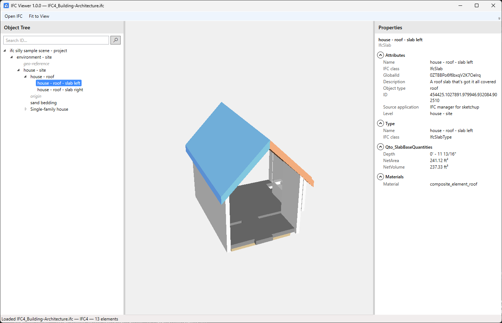

# IFC Viewer

**IFC Viewer** is a Windows desktop program, written in C# / WPF, for looking at 3D building models saved as
**IFC files**, the open file format that architects and engineers use to exchange building designs between
programs such as Revit, ArchiCAD or Tekla. You can turn the building around, zoom in on details and click on any
part of it.

*The buildingSMART sample "Building-Architecture" (IFC4) with a roof slab picked. Two small marker objects of the
file were hidden with the right-click menu.*

---

## What it can do

- **Open IFC files** — both common versions, IFC2x3 and IFC4, from small samples to files of several hundred MB.
  The program stays responsive while a file loads and shows the progress at the bottom of the window.
- **Show the building in 3D** — in the colors stored in the file. Glass is see-through. Parts the file
  doesn't color get a clear default color for their kind (see [Colors](#colors)).
- **Look around freely** — turn, move and zoom the model with the mouse; **Fit to View** shows everything.
- **Pick parts** — click a wall, window, beam or any other part and it lights up in blue. Hold **Ctrl** to pick
  several. The view then turns around the picked parts.
- **Show only what you need** — right-click to **isolate** the picked parts (hide everything else) or **hide**
  them; **Reset** shows everything again.
- **See the details** — the **Properties** panel on the right shows name, type, ID, level, all property sets,
  quantities and materials of the picked part. Lengths are in feet and inches (e.g. `9' - 10 7/64"`), areas in
  ft², volumes in ft³. With several parts picked, it shows what they have in common and **VARIES** where they differ.
- **Browse the building** — the **Object Tree** on the left lists every part by project, site, building and
  level. Click a name to pick that part; picking in 3D highlights it in the tree.
- **Find a part by its ID** — type an element ID (for Revit models: the Revit Element ID) in the search box above
  the tree and press Enter.
- **Remembers your setup** — window size and position, panel widths and the last opened folder.

### What it can't do

- Edit or save models, measure distances or cut sections.
- Open more than one model at a time.
- Search by name or other properties (only by ID).

### Known limitations

- **Some files contain invisible "volume" objects around the building** (for example *house - gross volume* in
  the buildingSMART samples). A click may pick that volume instead of the wall behind it. Right-click it →
  **Hide Selected Elements**, then click again.
- **Marker objects far from the building** (e.g. *origin*, *geo-reference*) make the model look small after
  opening. Hide them the same way and press **F**.
- A part made of differently colored pieces is drawn in the color of its first piece.
- **Very large models** (several hundred MB) take a few minutes to open, and a click there can take 1–2 seconds.
- IFC4x3 files (bridges, roads, rail) are not supported.

---

## Built with

| Part | Technology |
|---|---|
| Language / UI | C#, WPF on **.NET Framework 4.8** (x64), MVVM with CommunityToolkit.Mvvm 8.4 |
| IFC reading | **xBIM** — IFC2x3 and IFC4 through the shared `IIfc*` interfaces |
| Geometry | **xBIM Geometry 5.1** (Open CASCADE inside) turns IFC shapes into triangle meshes |
| 3D view | **HelixToolkit.Wpf.SharpDX 2.27** — DirectX 11 rendering, camera control and hit testing |

Each IFC element becomes one mesh, so a clicked mesh maps straight back to its element. Models over 100 MB are
kept in xBIM's on-disk storage instead of memory, which is what lets files of several hundred MB open.

---

## What you need

| | Requirement | How to check |
|---|---|---|
| Computer | Windows 10 or Windows 11, **64-bit** | Start → Settings → System → About → "System type" |
| Graphics | Any graphics card that supports DirectX 11 (practically every PC from the last 10 years) | Usually no need to check |
| .NET Framework 4.8 | Already part of Windows 11 and of Windows 10 (May 2019 update or newer) | Usually no need to check |
| Visual C++ Redistributable | **Microsoft Visual C++ 2015–2022 Redistributable (x64)**, needed by the 3D geometry engine. Most PCs already have it; a freshly installed Windows may not | Start → Settings → Apps → Installed apps → search "Visual C++". Missing? Install it from [Microsoft's download page](https://learn.microsoft.com/cpp/windows/latest-supported-vc-redist) (file `vc_redist.x64.exe`) |
| Memory | About 0.6 GB for a typical model (17 MB file); several GB for very large models (a 385 MB file needs about 5.5 GB) | Task Manager → Performance → Memory |
| Disk space | About 100 MB for the program; very large models (over 100 MB) temporarily need about 1.5× their file size on disk while open | |

---

## Build and run

1. Install **Visual Studio 2026** with the **.NET desktop development** workload (includes the .NET Framework 4.8
   targeting pack and the .NET 10 SDK).
2. `git clone` this repository (or **Code → Download ZIP**).
3. Open `IfcViewer.slnx`, select **Release** and **x64**, then **Build → Build Solution**.
   From a command line: `dotnet build IfcViewer.slnx -c Release -p:Platform=x64`
4. Run `src/IfcViewer/bin/Release/net48/IfcViewer.exe`.

Third-party packages are downloaded automatically during the first build. Settings and log files are kept in
`%LocalAppData%\IfcViewer`; delete that folder to reset them.

---

## How to use it

### Open a model

1. Click **Open IFC** at the top left (or press **Ctrl+O**).
2. Choose an `.ifc` file and click **Open**.
3. Wait until the bottom of the window says **Loaded …**. Typical files take a few seconds; very large files
   (over 100 MB) take a few minutes — the status bar then says *large file, kept on disk*.

### Look around

| To … | Do this |
|------|---------|
| Turn the model | Hold the **left** mouse button and move the mouse |
| Move the model | Hold the **right** mouse button and move the mouse |
| Zoom in and out | Turn the **mouse wheel** |
| See the whole model again | Click **Fit to View** (or press **F**) |

### Pick parts

- **Click** a part (without moving the mouse). It turns **blue**, and its details appear in the Properties panel.
- **Ctrl + click** adds a part to the picked ones, or removes it if it was already picked.
- Click the empty background (or press **Esc**) to un-pick everything.
- While parts are picked, turning the model turns around their middle.

Turning the model with the left mouse button doesn't change what is picked: the program only counts it as a
click when the mouse doesn't move.

### Show only some parts

**Right-click** a part to open a small menu:

| Menu item | What it does |
|---|---|
| **Isolate Selected Elements** | Shows only the picked parts and hides everything else |
| **Hide Selected Elements** | Hides the picked parts; everything else stays as it is |
| **Reset** | Shows every part again |

The first two are greyed out while nothing is picked. Right-clicking empty space shows only **Reset**. Hidden
parts are shown in grey italics in the Object Tree. **Fit to View** then frames only the visible parts.

### Read the properties

The **Properties** panel shows, for the picked part:

- **Attributes** — name, IFC class, GlobalId (the part's unique IFC identifier), description, **ID** (the
  identifier of the program that made the file — for Revit models the Revit Element ID), **Source application**
  (that program) and **Level**.
- **Type**, every **property set** (sets that come from the part's type are marked *(from type)*), **quantities**
  and **materials** (with layer thicknesses).

Values can be selected and copied. Rows the file leaves empty are shown empty.

With **several parts** picked, the header shows their kind and number, e.g. **Walls (3)**, or **Common (5)** for
different kinds. Only properties all of them have are listed; a value that differs between them shows **VARIES**.

### Use the Object Tree and search

- The tree lists the model as **project › site › building › level › parts**. Click a name to pick it,
  **Ctrl + click** to add it. Picking a part in 3D opens the tree at that part.
- **Search by ID:** type an ID in the box above the tree and press **Enter**. Every part with exactly that ID is
  picked and shown. For IDs written as a path with dots, the last number also works.

### Keyboard shortcuts

| Key | Action |
|-----|--------|
| **Ctrl+O** | Open a file |
| **F** | Fit to View |
| **Esc** | Un-pick everything |
| **Enter** (in the search box) | Search |

### Where to get example files

You can try the program with the free example files from
**[buildingSMART Sample Test Files](https://github.com/buildingSMART/Sample-Test-Files)**: open a folder,
click a file ending in `.ifc`, then click the download button.

---
## Colors

Each part is shown in the color saved in the IFC file. Only parts **without** a color in the file get the
default color for their kind, listed below.

There is no official standard for these colors: the IFC format itself doesn't define any.[^ifc] The defaults
follow a common practice in building design: one color per kind of part (as in Revit's categories), so
different parts are easy to tell apart,[^scheme] with building services in the usual colors: ducts blue,
pipes green, electrical yellow.[^mep]

| Group | Kind of part | Default color |
|---|---|---|
| Building | Walls | warm off-white |
| | Windows, glass panels, curtain walls | light blue, see-through |
| | Doors | brown |
| | Floors and slabs | concrete grey |
| | Roofs | terracotta |
| | Ceilings | near white |
| | Stairs and ramps | sand |
| | Railings | dark metal grey |
| | Furniture and cabinets | light wood |
| Structure | Columns | orange |
| | Beams | purple |
| | Braces, curtain wall frames | steel grey |
| | Foundations and piles | dark earth grey |
| | Reinforcement bars | rust red |
| Building services | Ducts | blue |
| | Pipes | green |
| | Cable trays | yellow |
| | Ducts and pipes in older IFC2x3 files (type unknown) | teal |
| | Toilets, sinks and other plumbing fixtures | white |
| | Lights | light yellow |
| | Equipment, air outlets, other services | blue-grey |
| Other | Everything else | grey |

Good to know:
- The **blue** of a picked part is brighter and stronger than any of these colors, so you can always see what
  is picked.
- Parts that a file marks as completely invisible are shown faintly see-through, so they can still be found.
- Rooms, zones and the "holes" for doors and windows are not drawn: they are invisible areas in the file, not
  real building parts.

[^ifc]: buildingSMART Forums, "Color meaning in IFC Standard". The colors in the IFC documentation only mark
    kinds of classes in diagrams; the standard does not prescribe element colors.
    <https://forums.buildingsmart.org/t/color-meaning-in-ifc-standard/4103>

[^scheme]: "BIM Color Coding": an example project color scheme with separate colors for foundations, columns,
    framing, walls and floors, plus pipe and duct systems.
    <https://www.scribd.com/document/422150043/BIM-Color-Coding>

[^mep]: U.S. General Services Administration (GSA), "BIM Technical Standards: MEP Color Mapping": one color
    per building-services system.
    <https://www.scribd.com/document/547192528/BIM-Technical-Standards-MEP-Color-Mapping-GSA>

---

## Problems and questions

**The program doesn't start.**
Make sure it was built for **x64**. If it still doesn't start, install the **Microsoft Visual C++
Redistributable (x64)** from
[Microsoft's download page](https://learn.microsoft.com/cpp/windows/latest-supported-vc-redist) and try again.

**I get an error when opening a file.**
The message says why. Most often the file is damaged or not a real IFC file (for example a renamed file of
another type): open it in the program it came from and export it again as IFC2x3 or IFC4. If the file is open in
another program, close it there first.

**"This model is too large for the memory currently available."**
Very large models need several GB of memory for the 3D view. Close other programs (browsers, other design
software) and try again.

**The 3D view stays empty and a message says "No 3D geometry".**
The file only contains information, no shapes. You can still browse it in the Object Tree and read the
properties.

**The window opens in a strange place or the panels are too narrow.**
Close the program and delete the file `%LocalAppData%\IfcViewer\settings.xml`; it starts with the default
layout again.

**The model looks very small after opening.**
The file contains something far away from the building (for example a small marker object). Zoom in with the
mouse wheel, or pick the marker (in 3D or in the Object Tree), right-click → **Hide Selected Elements** and press **F**.

**Something else?**
Open an issue on the **[Issues page](../../issues)** and describe what you did, what you expected and what
happened. If possible, attach the log file from `%LocalAppData%\IfcViewer\logs` (it lists which files were
opened and any errors). Please don't attach models with private or confidential data.

---

## Privacy

IFC Viewer works completely on your computer. It does **not** send your files or any other data over the
internet, and it does not collect usage statistics. It stores only these files, in `%LocalAppData%\IfcViewer`:

- `settings.xml` — window size and position, panel widths, last opened folder
- `logs\` — a log file per day (names of opened files, load times, errors); files older than two weeks are deleted
- `Temp\` — temporary copies of very large models while they are open; removed when the program closes or starts
